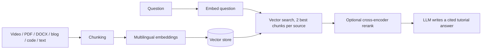

# 📚 Study Assistant: a RAG lab for videos, documents, blogs and code

Add a YouTube video, PDFs or Word files, blog links, pasted text and code files, then ask a
question. The app retrieves the best passages from **all** of your material and explains the
answer in plain language, with a diagram, a worked example, key terms and self-check
questions, and it cites where each fact came from.

A second page, **Detailed Analysis**, opens up the pipeline so you can see (and explain) every
choice: how the text was chunked, how many tokens the embedding model really reads, how
retrieval and reranking score each passage, and how five chunking strategies compare.

**Live demo:** `https://huggingface.co/spaces/[YOUR_USERNAME]/[YOUR_SPACE_NAME]`

## What it does

| Home page | Detailed Analysis page |
|---|---|
| Add a video link, files (PDF, DOCX, TXT, MD, CSV, PY, SQL, R, JS), blog links or pasted text | **Overview and chunks**: pipeline diagram and chunk visualization for 5 strategies |
| Tiles: videos, documents, code files, PDF pages, chunks, average tokens | **Token inspection**: which tokens the embedder reads, and an overflow before/after test |
| Auto summary of the material | **Query and retrieval**: timed pipeline of embed, vector search, optional rerank, answer |
| Question box with three styles: step-by-step tutorial, explain like I'm 10, exam revision notes | **Compare strategies**: same text and question across strategies, with Excel export |
| Optional concept diagram drawn from the answer | **Why this method**: each design choice with its trade-off |
| **Previous study**: topic, date, material, questions and answers | |

## How it works



1. **Load**: YouTube captions (with timestamps), PDF pages, Word text, blog articles, code files.
2. **Chunk**: recursive splitting with overlap; code is split with language-aware separators;
   video chunks keep their start time so every citation links back to the exact second.
3. **Embed**: `paraphrase-multilingual-MiniLM-L12-v2` (runs locally, free, many languages).
4. **Retrieve**: cosine similarity over an in-memory vector store, taking the 2 best chunks from
   every source so the video, each document and each blog all contribute.
5. **Rerank (optional)**: a multilingual cross-encoder re-reads the question and each candidate.
6. **Answer**: an open-source LLM served by Groq is told to answer only from the excerpts and to
   cite them.

## Design decisions and what I measured

- **Chunk size.** In my test on one lecture video, with 900-character chunks every one of the 74
  chunks was longer than the embedding model's 128-token limit (see the *Over 128 tokens*
  column in **Compare strategies**). The model silently ignores the rest of a chunk, so the
  default is now 450 characters. The *Token inspection* tab shows this directly.
- **Balanced retrieval.** Pure similarity let one source crowd out the others, so the default
  takes the 2 best chunks per source.
- **Five chunking strategies** (fixed-size, recursive, sentence-based, semantic, hierarchical
  parent-child) so the trade-offs can be compared on the same text.
- **Free and open source throughout.** Local embeddings, open models, no paid services.
- **Privacy.** On the public site nothing is stored on the server; history lives only in the
  visitor's session and can be downloaded and restored.

## Tech stack

Python, Streamlit, LangChain (`langchain-core`, `langchain-groq`, `langchain-huggingface`,
`langchain-text-splitters`), sentence-transformers, Groq (`openai/gpt-oss-20b`),
youtube-transcript-api, pypdf, python-docx, trafilatura, pandas.

## Run it on your computer (Windows, PowerShell)

```powershell
git clone https://github.com/[YOUR_USERNAME]/[YOUR_REPO].git
cd [YOUR_REPO]
python -m venv .venv
.venv\Scripts\activate
pip install -r requirements.txt
copy .env.example .env        # then open .env and paste your free Groq key
streamlit run app.py
```

Get a free key at [console.groq.com](https://console.groq.com). Never commit your `.env` file.
Run it with `streamlit run app.py` (not the editor's Run button).

## Deploy to Hugging Face Spaces

This repo is ready as a **Docker** Space (Hugging Face no longer offers a built-in Streamlit
option; the `Dockerfile` and the header at the top of this README configure it).

1. Create a new Space, choose the **Docker** SDK, then upload these files.
2. In **Settings → Variables and secrets**, add a secret named `GROQ_API_KEY`.
3. Wait for the build to finish. Visitors can also paste their own free Groq key in the app, so
   one visitor can't use up the shared quota.

## Known limitations

- **YouTube may block caption downloads from cloud servers.** If it does, paste the transcript
  into the *Or paste text* box.
- Some blogs block automated readers or need a login; paste the text instead.
- The embedding model reads only 128 tokens per chunk, so chunks are kept small. A longer-context
  embedding model would allow larger chunks but is heavier to run.
- Free hosting sleeps when idle and the first request after a restart is slow.
- The index is in memory and disappears when the page is refreshed.
- The app disables Streamlit's XSRF/CORS checks in the Docker file so file upload works inside the
  Hugging Face page frame. Don't reuse that setting for an app that handles logins.

## Roadmap

Query rewriting with chat history, persistent per-user storage, scanned-PDF OCR, evaluation set
with retrieval hit-rate and answer-faithfulness measurements, LangGraph routing and self-check.

## Credits

The idea of a chunking "visualizer" was inspired by a course demo from `[COURSE / INSTRUCTOR NAME]`.
This project is an independent LangChain implementation with different code, models and features.
